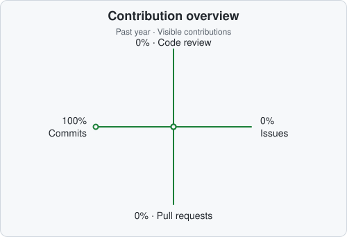

# Hi, I'm Aki 👋

High school student in Japan.

I share what I build and explore here on GitHub.

[GitHub profile](https://github.com/aki0804) · [Public repositories](https://github.com/aki0804?tab=repositories)

## 🧰 Formats in my public repositories

## 📈 GitHub activity

<picture>
  <source media="(prefers-color-scheme: dark)" srcset="https://github-stats-extended.vercel.app/api?username=aki0804&amp;custom_title=GitHub%20Stats%20%7C%20Development%20Overview&amp;show_icons=true&amp;include_all_commits=true&amp;hide=contribs&amp;show=prs_merged%2Cprs_merged_percentage%2Creviews%2Ccontributions&amp;number_format=long&amp;role=OWNER%2CORGANIZATION_MEMBER%2CCOLLABORATOR&amp;hide_rank=false&amp;rank_icon=default&amp;card_width=500&amp;line_height=27&amp;border_radius=10&amp;disable_animations=true&amp;theme=dark_github&amp;bg_color=0d1117&amp;border_color=30363d&amp;title_color=58a6ff&amp;text_color=e6edf3&amp;icon_color=a371f7&amp;ring_color=58a6ff">
  
</picture>

<picture>
  <source media="(prefers-color-scheme: dark)" srcset="./assets/contribution-overview.dark.svg">
  
</picture>

<picture>
  <source media="(prefers-color-scheme: dark)" srcset="https://streak-stats.demolab.com/?user=aki0804&amp;locale=en&amp;theme=github-dark-blue&amp;hide_border=true&amp;background=00000000">
  
</picture>

<picture>
  <source media="(prefers-color-scheme: dark)" srcset="https://github-readme-activity-graph.vercel.app/graph?username=aki0804&amp;theme=github-compact&amp;hide_border=true&amp;days=31&amp;custom_title=GitHub%20Activity">
  
</picture>
